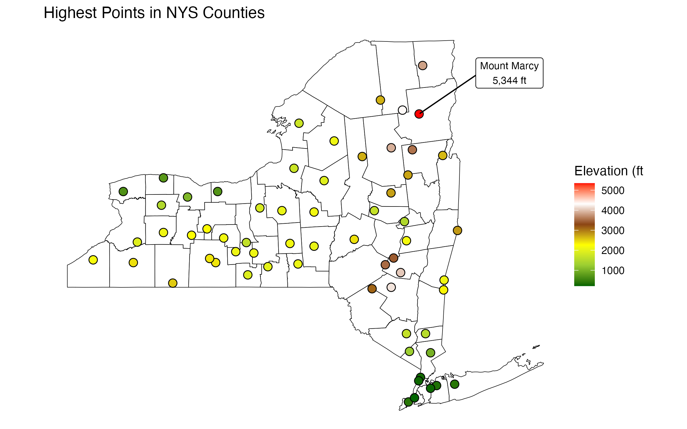
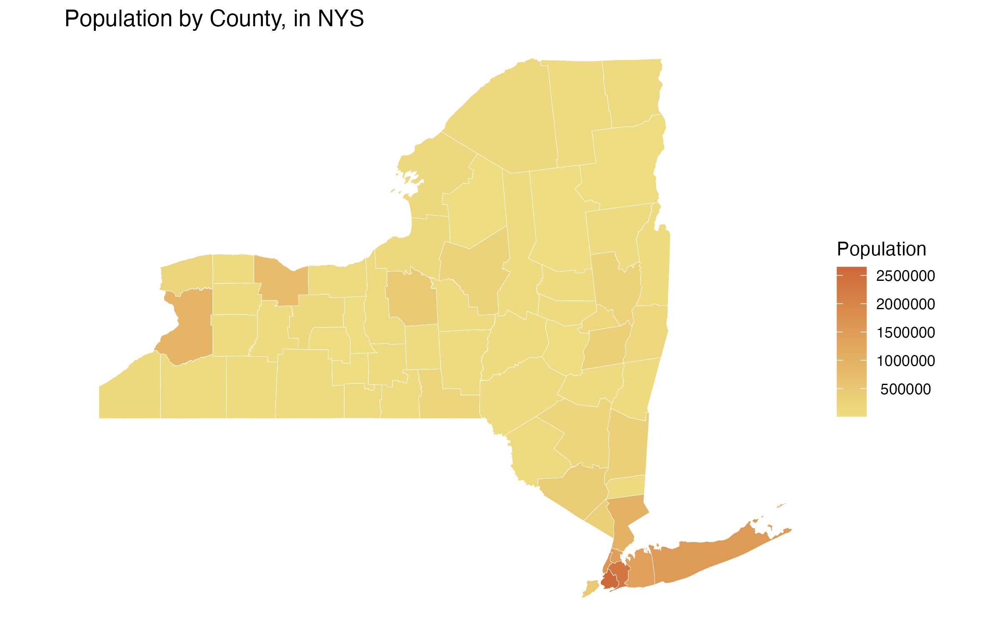
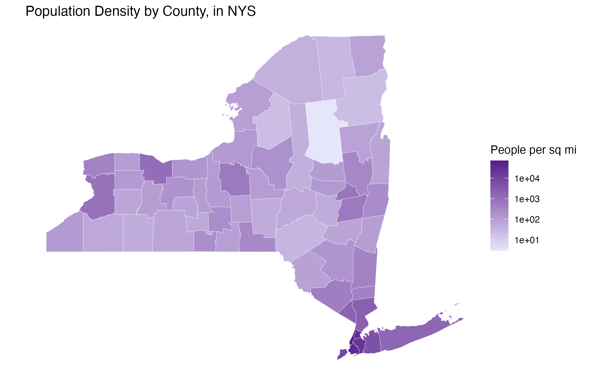
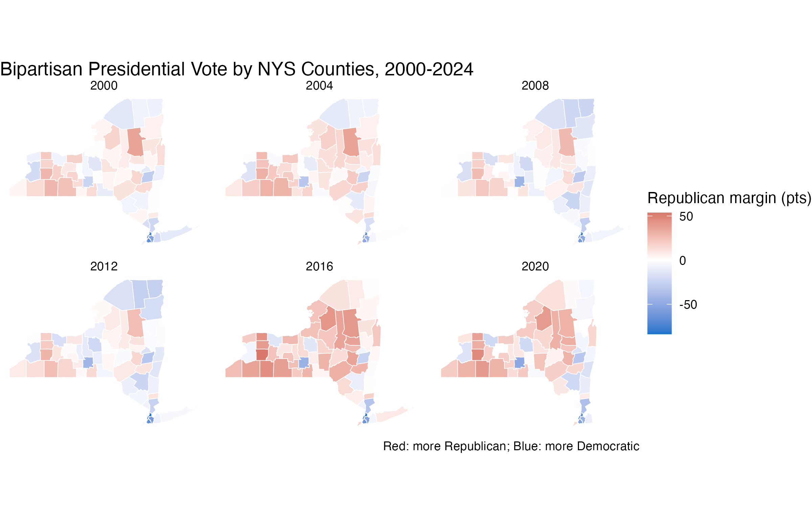

## Background + Steps 

For this practicum I heavily referenced my Assignment 10 code especially with checking how to make the sf R objects and the overall mapping code. I had the most difficulty when it came to the Census data because of the key situation. For most of the graphs, I had to look up what the different scale gradients did and how they differed. Since some of the maps wanted a scale vs specific colors, I wanted to check which function to use. 

## Question 1: A Map of NYS Counties with the Highest and Lowest Points
{fig-align= "center" width="70%"}

The highest point in NYS is in Essex County and it's called Mount Marcy. Its elevation is 5,344 feet or 1,629 meters. The lowest point in NYS County is in Kings County, called Battle Hill. Its elevation is 220 feet or 67 meters. 

## Question 2: Map of NYS Counties by Population 
{fig-align= "center" width="70%"}

This map represents the population by county in NYS. The county that is the most populous is Kings County with a number of 2,646,306 people. While Hamilton County has the least populous with a population of 5,102. 

## Question 3: Map of NYS Counties by Population Density 
{fig-align= "center" width="70%"}

This map represents the population density by county in NYS. The county with the most highest population density is New York County, with a population density of 71,842. While Hamilton County is the least densely populated county with a population density of 2.97. 

## Question 4: Map of NYS Counties of Presidential Elections
{fig-align= "center" width="70%"}

It's interesting to note that from 2000-2023, is that over time, especially in 2016, there is a noticeable shift in the amount of red shades and becoming more Republican. The colors became deeper and it can be inferred that bipartisan has become more of a trend. There are also some counties who did experience a shift from a Democratic margin, to a Republican margin, which is interesting. In 2016 specifically, the colors are the most deeper, showing a higher margin, which is interesting because this is when President Trump ran against Hillary Clinton. That campaign was interesting because it was a women running, and many conversations were happening where people believed that women couldn't be president. So seeing a more Republican margin makes sense, because people rather voted for Trump this year. 

